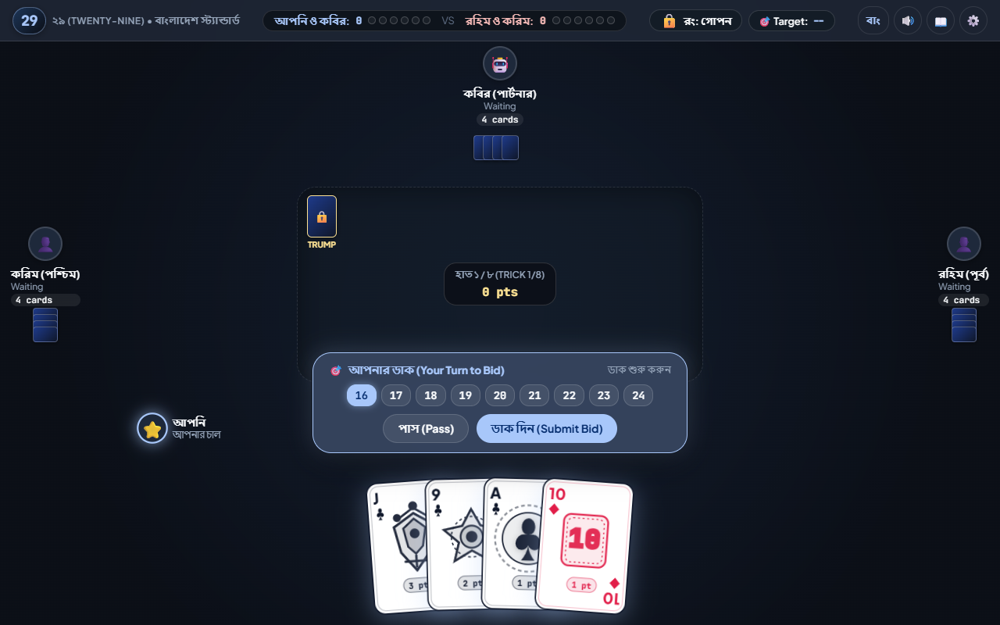

<div align="center">

# ♠️ ২৯ (Twenty-Nine) Card Game ♥️
### Google Material Design 3 • Authentic South Asian Edition

[](https://zhsaikot.github.io/29-Game-zhs/)
[](https://m3.material.io/)
[-orange?style=for-the-badge)](https://developer.mozilla.org/en-US/docs/Web/JavaScript)
[](LICENSE)

<br/>



<br/>

*An authentic, production-ready, ultra-polished web implementation of the classic South Asian trick-taking card game **"29" (Twenty-Nine)**. Built with 100% pure vanilla ES6+ JavaScript, modern CSS3 Glassmorphism, and custom inline SVG vector artwork. Completely serverless and static, ready for instant one-click deployment to GitHub Pages.*

</div>

---

## 🌟 Key Highlights & Features

### 🎨 1. Google Material Design 3 & Glassmorphic HUD
- **Deep Obsidian Slate (`#0B0F17`) Theme:** Elevated glassmorphic surfaces (`backdrop-filter: blur(16px)`), ambient arena glow (`#131B26`), and tonal borders.
- **Material You Accents:** Google Pastel Blue (`#A8C7FA`), Pastel Coral (`#F2B8B5`), Pastel Mint (`#C4EED0`), and Golden Honey (`#FDE293`).
- **Typography:** Loaded from Google Fonts — `'Cinzel'` and `'Merriweather'` for regal royal card headings, `'Outfit'` and `'Plus Jakarta Sans'` for sleek UI, and `'JetBrains Mono'` for high-precision scores and bids.
- **Player Profile Avatars:** Choose from curated preset avatars (Lion King, Monarch, Dire Wolf, Sly Fox, Ninja, Arcane Mage, Cyber AI, Bengal Tiger) or upload any custom photo/icon with automatic circular masking!

### 🃏 2. Luxury Playing Card Deck (Bicycle / Theory11 Hybrid)
- **100% Pure Inline SVG:** Ultra-crisp vector rendering on any device or resolution with zero raster images.
- **Authentic Traditional Pip Layouts (7, 8, 9, 10):** Precise playing-card coordinates with upper pips pointing up and lower pips inverted 180°, plus subtle gold inner glow on Nine (2 pts).
- **Double-Headed Mirrored Royal Court Cards (J, Q, K):**
  - **Jack (J - 3 pts):** Royal Halberd/Spear, Gold Prince Crown, Shield with suit emblem, and luxury gold border.
  - **Queen (Q):** Sovereign Tiara, Tudor Rose/Scepter, and mirrored portrait.
  - **King (K):** Imperial Cross Crown, Broadsword, and Royal Crest.
  - **Ace (A - 1 pt):** Oversized ornate central pip with intricate filigree engravings.
- **Micro Point Badge:** Sleek, high-contrast micro-pill integrated cleanly at the bottom border.
- **Rock-Solid Stability:** Zero jitter or jumping — cards maintain fixed, stable coordinates without disorienting hover displacement.
- **Trick-Winner Animation:** On trick completion, cards glide smoothly to the winning player's pod, accompanied by a celebratory winner avatar pulse!

### 🇧🇩 3. 100% Authentic South Asian / Bangladeshi Rules
- **32-Card Deck:** Spades (♠), Hearts (♥), Clubs (♣), Diamonds (♦).
- **Point Hierarchy:** Jack (3) > 9 (2) > Ace (1) > 10 (1) > King (0) > Queen (0) > 8 (0) > 7 (0). Total = 28 pts + 1 bonus point for the 8th trick = **29 Points**.
- **Two-Phase Dealing:** 4 cards dealt initially ➔ Bidding from 16 to 28 (or Pass) ➔ Hidden Trump locked on table slot ➔ Remaining 4 cards dealt (total 8 cards each).
- **Active Bidders System:** Once a player passes, they cannot bid again in that round. Bidding circulates strictly among active players.
- **Fair Trump Mechanics:** Only the Bidder knows the secret trump suit before it is revealed. No player can lead trump prior to reveal (unless holding only trumps).
- **Trump Reveal (রং তোলা):** Anyone void in the led suit can reveal the secret trump with a dramatic 3D flip animation. The revealing player must play trump if holding one.
- **Marriage / Royals (জোড়া):** Holding both King & Queen of the Trump suit allows declaring Marriage, adjusting the target bid by **4 points**!
- **Double & Redouble:** Interactive multiplier challenges (x2 and x4 game points).
- **High Bid Bonus:** Winning a bid of 21 or higher automatically earns **2 Game Points** on success.

### 🤖 4. Fair & Smart Heuristic AI
- **Zero-Cheating Guarantee:** AI players do not secretly know the hidden trump suit until it is legitimately revealed.
- **Partner Awareness:** Recognizes when partner has already secured the trick with a boss card, intelligently loading high points (পাঞ্জা দেওয়া) or dumping zero-point trash cards.
- **Memory Card Counter:** Tracks played Jacks and Nines to know when Aces and 10s become boss cards.
- **Live Speech Bubbles:** Opponents and partners express real-time reactions (*"১৬"*, *"পাস!"*, *"রং তুললাম!"*, *"কাটলাম!"*) next to their avatars!

### 🔊 5. Zero-Dependency Procedural Web Audio Engine
- Built using the native browser `AudioContext` without any external `.mp3` or `.wav` files:
  - Soft card slide & deal whooshes
  - Crisp card drop snap
  - Golden arpeggio chime on Trump Reveal
  - Royal fanfare on Marriage announcement
  - Triumphant rising chords for round victory
- Built-in Mute/Unmute toggle.

### 🌐 6. Instant Bilingual Support (English ⇄ বাংলা)
- Single-click toggle (`বাং / EN`) in the top HUD switches all player names (*আপনি, কবির, রহিম, করিম*), suit names (*ইসকাপণ, হরতন, চিড়িতন, রুইতন*), rules, dialogs, and toasts between English and authentic Bengali!

---

## 🏆 Card Hierarchy & Point Values

| Rank | Name (English) | নাম (বাংলা) | Power | Points | Traditional Note |
| :---: | :---: | :---: | :---: | :---: | :---: |
| **J** | Jack | গোলাম (J) | 8 (Highest) | **3 pts** | Highest power card in every suit |
| **9** | Nine | নহলা (9) | 7 | **2 pts** | Second highest card |
| **A** | Ace | টেক্কা (A) | 6 | **1 pt** | Honor card |
| **10** | Ten | দহলা (10) | 5 | **1 pt** | Honor card |
| **K** | King | সাহেব (K) | 4 | **0 pts** | Part of Marriage pair |
| **Q** | Queen | বিবি (Q) | 3 | **0 pts** | Part of Marriage pair |
| **8** | Eight | আট (8) | 2 | **0 pts** | Trash / probe card |
| **7** | Seven | সাত (7) | 1 (Lowest) | **0 pts** | Lowest power card |

> **Last Trick Bonus:** Winner of the 8th (final) trick receives **+1 bonus point**, bringing total round points to **29**.

---

## 📁 Project Architecture

```text
29-Game-zhs/
├── index.html              # Semantic HTML5 shell, M3 HUD, Dialogs, Floating Dock
├── README.md               # Documentation & Guide
├── assets/
│   └── preview.png         # High-resolution game preview
├── css/
│   ├── variables.css       # Material 3 tokens, colors, elevation shadows
│   ├── layout.css          # Responsive arena grid, player pods, floating docks
│   └── cards.css           # Pure SVG card styles, fan calculation, 3D flips
└── js/
    ├── constants.js        # Suits, ranks, power, points, bilingual dictionaries
    ├── cardRenderer.js     # High-contrast pure SVG vector generator
    ├── audio.js            # Zero-dependency Web Audio API synthesizer
    ├── gameState.js        # Full 29 state machine & authentic scoring rules
    ├── aiEngine.js         # Heuristic fair AI decision bot
    └── main.js             # UI Controller, 1.2s cinematic sequencer & bindings
```

---

## ⚡ How to Run Locally

Because the project is 100% static ES6 modules, simply serve the repository with any HTTP server:

### Option A: Using Python
```bash
python -m http.server 8080
```
Open [http://localhost:8080](http://localhost:8080) in your web browser.

### Option B: Using Node.js
```bash
npx serve .
```

---

## 🚀 Deploying to GitHub Pages

1. Fork or clone this repository:
   ```bash
   git clone https://github.com/zhsaikot/29-Game-zhs.git
   cd 29-Game-zhs
   ```
2. Go to **Settings > Pages** in your GitHub repository.
3. Under **Branch**, select `main` (or `master`) and `/ (root)`.
4. Click **Save**. Your game will be live at:
   `https://<your-username>.github.io/29-Game-zhs/`

---

## 📜 License

Distributed under the **MIT License**. Free to play, learn, fork, and enjoy!

---

<div align="center">
Crafted with ❤️ for lovers of classic South Asian card games.
</div>
